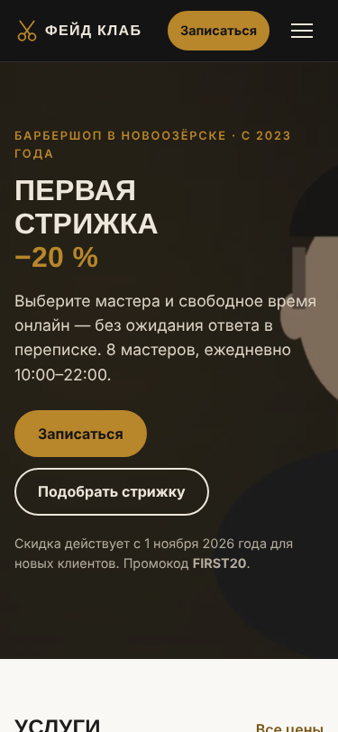
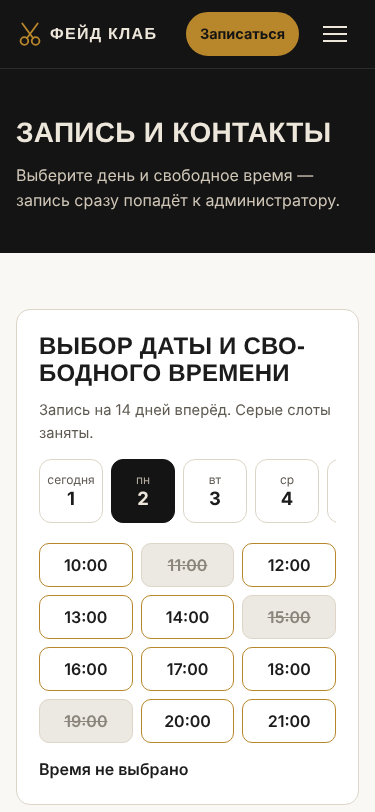
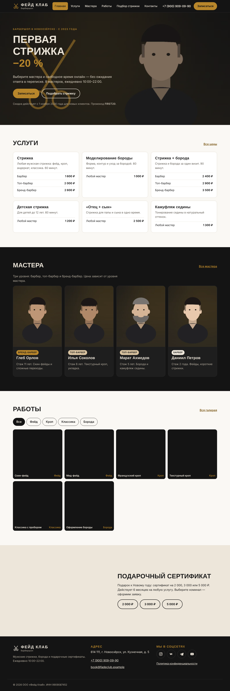
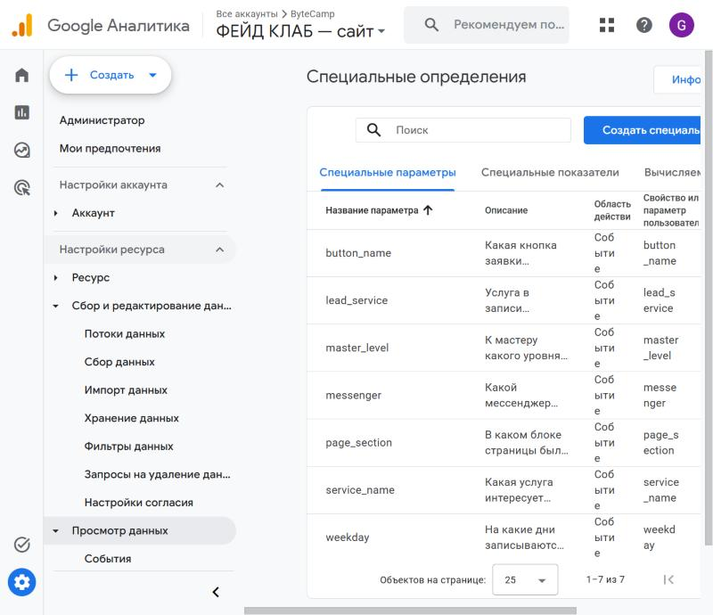
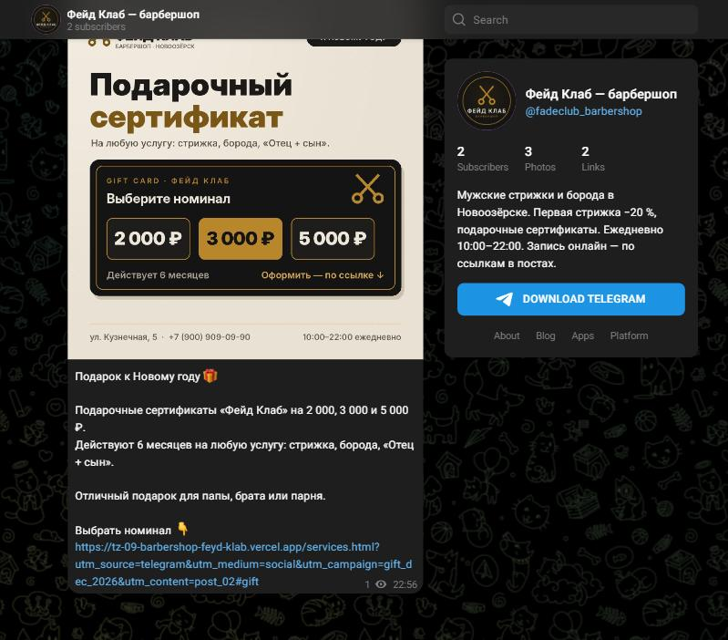
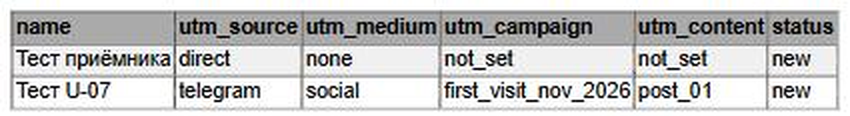
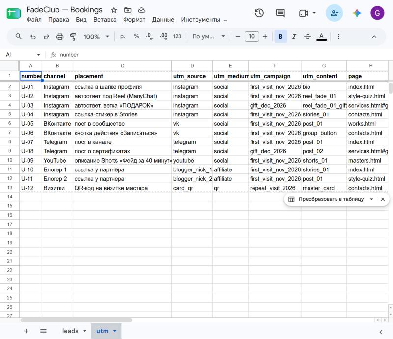
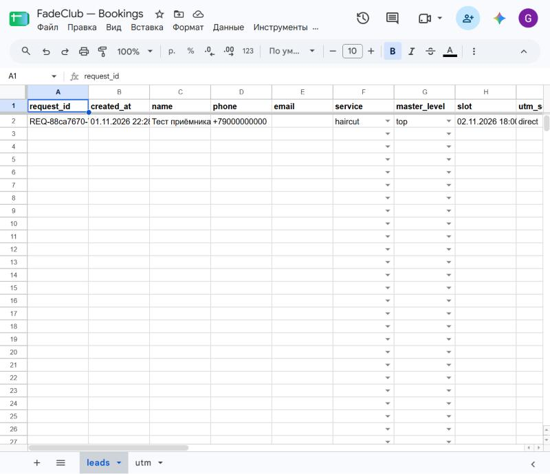
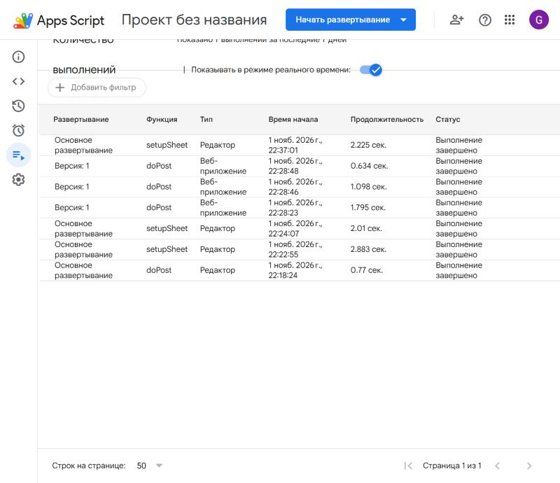

# Фейд Клаб — сайт барбершопа, аналитика и онлайн-запись

Практическая работа по дисциплине ОП.03 «Информационные технологии», техническое задание № ТЗ-09/2026.

**Исполнитель:** Вобленко Глеб Владимирович, группа ___

## Ссылки

| Что | Ссылка |
|---|---|
| Сайт на Vercel | https://tz-09-barbershop-feyd-klab.vercel.app |
| Репозиторий | https://github.com/GlebHadt/tz-09-barbershop-feyd-klab |
| Таблица заявок «FadeClub — Bookings» (листы `leads`, `utm`) | https://docs.google.com/spreadsheets/d/192vY4NM72ONFR1dw1VVXOqktPy1bSgq6Hi04JPIQhh4/edit?usp=sharing (просмотр по ссылке) |
| Приёмник заявок (Apps Script, веб-приложение) | https://script.google.com/macros/s/AKfycbwCd5c9u1UlvDHdieAXcrwijytIZp3OKdwBBFWaPLxn3PLh43UUoafIim3o2l67F13i/exec |
| Отчёт PageSpeed Insights (Lighthouse, мобильный) | https://pagespeed.web.dev/analysis/https-tz-09-barbershop-feyd-klab-vercel-app/o25sdnhhhg?form_factor=mobile&hl=ru |
| Telegram-канал «Фейд Клаб — барбершоп» | https://t.me/fadeclub_barbershop (посты со ссылками: [U-07](https://t.me/fadeclub_barbershop/4), [U-08](https://t.me/fadeclub_barbershop/5)) |
| Дашборд DataLens | не выполнен (см. «Не получилось») |

**Ресурс GA4:** «ФЕЙД КЛАБ — сайт», идентификатор потока **G-H77TTNTSYH**
**Доступ Заказчику:** выдаётся по ссылке на таблицу заявок и на этот репозиторий.

---

## Что сделано

### 3. Сайт — выполнено

- 8 страниц и `404.html`: `index`, `services`, `masters`, `works`, `style-quiz`, `contacts`, `thanks`, `privacy`. Порядок блоков — по Приложению А.
- Статические HTML, CSS и JavaScript без сборки. Тексты только по сведениям из раздела 2 ТЗ. Цвета #141414 / #B8862B / #EDE6DA, шрифты Oswald и Inter.
- Единые шапка и подвал, в меню выделена текущая страница. Адаптив проверен на 375, 768 и 1280 px: горизонтальной прокрутки нет, кнопки не меньше 44 × 44 px.
- У каждой страницы свои `title`, `description`, Open Graph (картинка 1200 × 630) и favicon. Изображения в WebP/JPEG до 300 КБ, у всех заполнен `alt`. Источники — в `docs/images.md`.
- **Lighthouse главной (мобильный):** Performance **79** (нужно ≥ 70), Accessibility **100** (≥ 90), SEO **100** (≥ 90).
- Запись на время: календарь на 14 дней, слоты 10:00–21:00, занятые слоты задаются массивом в `js/form.js`. Флажок согласия со ссылкой на `privacy.html`. На `thanks.html` — номер записи и файл `.ics`.
- Публикация на Vercel с автообновлением после каждого push в `main`. В репозитории больше 10 коммитов.
- Журнал запросов к нейросети — `docs/prompts.md`.

| Главная, телефон | Запись, телефон | Главная, компьютер |
|---|---|---|
|  |  |  |

Остальные страницы — в `screens/site/`. Отчёт Lighthouse — `screens/lighthouse/mobile.jpg`.

### 4. Веб-аналитика GA4 — выполнено, кроме ключевых событий

- Ресурс «ФЕЙД КЛАБ — сайт», веб-поток с адресом Vercel, расширенная статистика включена, в том числе формы (`screens/ga4/stream.jpg`).
- Тег `gtag.js` с G-H77TTNTSYH стоит в `<head>` всех 9 страниц.
- Все 20 событий (18 обязательных и 2 «по выбору»: `promo_copy`, `map_open`). Все вызовы `gtag('event', …)` собраны в `js/analytics.js`, кнопки размечены атрибутами `data-event`. Таблица событий с файлами и строками — `docs/events.md`.
- `generate_lead` отправляется только после ответа приёмника `{"ok": true}`. Имя, телефон и e-mail в GA4 не передаются.
- Созданы 7 пользовательских параметров уровня события: `button_name`, `page_section`, `service_name`, `master_level`, `weekday`, `lead_service`, `messenger` (`screens/ga4/custom-definitions.jpg`).
- События `generate_lead`, `contact_click`, `messenger_click`, `slot_select`, `form_start` проверены в Realtime (`screens/ga4/realtime-generate_lead.jpg`).



### 5. UTM-разметка и Telegram — выполнено по согласованному объёму

- Реестр U-01…U-12 ведётся на листе `utm` таблицы. Полная ссылка собирается формулой из столбцов меток, выгрузка — `docs/utm.csv` (`screens/sheets/utm.jpg`).
- Telegram-канал **«Фейд Клаб — барбершоп»** создан от имени компании: https://t.me/fadeclub_barbershop. Аватар и карточки к постам лежат в `docs/telegram-avatar.png` и `docs/telegram/`, тексты постов — в `docs/telegram-posts.md`.
- Опубликованы 3 поста: приветствие и два поста со ссылками из реестра. Адрес поста и дата публикации внесены в реестр.

| Строка | Пост | Ссылка ведёт на | Проверка переходом из поста |
|---|---|---|---|
| U-07 | [t.me/fadeclub_barbershop/4](https://t.me/fadeclub_barbershop/4) | `index.html?utm_source=telegram&utm_medium=social&utm_campaign=first_visit_nov_2026&utm_content=post_01` | все 4 метки в адресе; заявка «Тест U-07» записалась с метками `telegram / social / first_visit_nov_2026 / post_01` |
| U-08 | [t.me/fadeclub_barbershop/5](https://t.me/fadeclub_barbershop/5) | `services.html?utm_source=telegram&utm_medium=social&utm_campaign=gift_dec_2026&utm_content=post_02#gift` | все 4 метки в адресе, якорь `#gift` после меток |

- QR-код ссылки U-12 — `docs/qr-u-12.png`, афиша A4 — `docs/afisha.pdf`.

| Пост U-08 в канале | Заявка «Тест U-07» в таблице |
|---|---|
|  |  |



### 6. Приём заявок — выполнено

- Таблица «FadeClub — Bookings», лист `leads`. Заголовки в порядке ТЗ, выпадающие списки `status`, `service`, `master_level`, подсветка пустых обязательных ячеек и повторяющихся `request_id`.
- Приёмник `apps-script/Code.gs`, функция `doPost(e)`, опубликован как веб-приложение. Он сам проверяет обязательные поля, телефон, e-mail, списки и длину строк. Сам ставит `created_at` и `status = new`.
- Повторная отправка с тем же `request_id` не создаёт строку: приёмник отвечает `{"ok": false, "error": "duplicate_request_id"}` (испытание И-05 проверено). Телефон «123» отклоняется с ошибкой `format:phone`.
- Форма отправляется через `fetch` без перезагрузки. UTM-метки хранятся в `sessionStorage`, при ошибке поля отправляется `form_error`. Контрольная заявка с сайта дошла до таблицы.

| Лист leads | Выполнения приёмника |
|---|---|
|  |  |

### 8. Отчётность

Отчёты и исследования GA4 и аналитическая записка `docs/report.md` строятся через 24–48 часов после проверок, когда в ресурсе накопятся данные.

---

## Объём работ, согласованный по ходу выполнения

| Раздел ТЗ | Решение |
|---|---|
| 5. Соцсети | Ссылки публикуются только в Telegram (U-07, U-08) и на QR-коде (U-12). Instagram, ВКонтакте, YouTube и блогеры-партнёры (U-01…U-06, U-09…U-11) не используются. |
| 7. Автоответы Instagram (ManyChat) | Не выполняется: Instagram недоступен. Страница `style-quiz.html`, на которую ведёт автоответ, готова. |
| 8.4. Дашборд DataLens | Не выполняется: сервис не работает. |
| Доступ Заказчику | Ссылка на таблицу и репозиторий вместо выдачи доступа по e-mail. |

## Структура репозитория

```
index.html services.html masters.html works.html style-quiz.html
contacts.html thanks.html privacy.html 404.html
css/style.css
js/analytics.js  — все события GA4
js/main.js       — меню, сохранение UTM, фильтры работ и мастеров
js/form.js       — календарь слотов и отправка формы
js/quiz.js       — тест «Форма лица»
js/thanks.js     — номер записи и файл .ics
img/  files/fade-club-price.pdf
apps-script/Code.gs — приёмник заявок + setupSheet()
docs/ prompts.md events.md utm.csv images.md report.md telegram-posts.md afisha.pdf qr-u-12.png
screens/ site/ ga4/ sheets/ apps-script/ lighthouse/ utm/ reports/ explore/
```

---

Не получилось: автоответы Instagram через ManyChat (Instagram недоступен), дашборд в Yandex DataLens (сервис не работает); стандартное ключевое событие `purchase` в GA4 снять нельзя — кнопка неактивна, на сайте оно не отправляется.

Нейросеть использовалась для: генерации сайта (HTML, CSS, JavaScript), иллюстраций, кода приёмника Apps Script, документации в `docs/`, настройки GA4, таблицы заявок и публикации через браузер, проверки сайта и снимков экрана.
